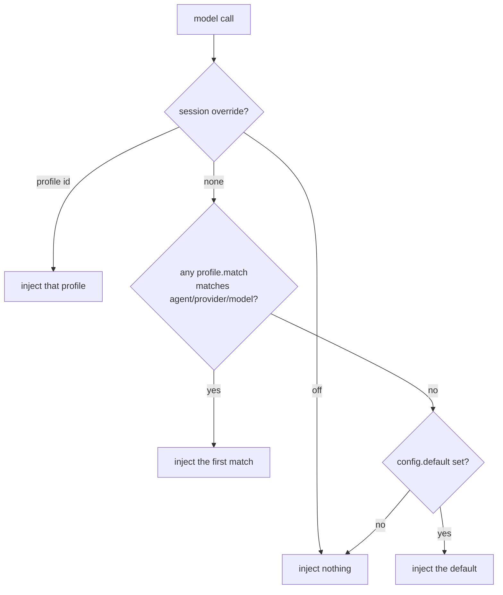

<p align="center">
  
</p>

<p align="center">
  <a href="https://www.npmjs.com/package/opencode-purge"></a>
  <a href="https://github.com/zehedisode/opencode-purge/actions/workflows/ci.yml"></a>
  <a href="LICENSE"></a>
  
</p>

<p align="center">
  <b>Swap system prompts, rulesets and host policy per model — by declaring a file, not by patching the host.</b>
</p>

---

OpenCode assembles one system prompt per request. `opencode-purge` lets you take control of that moment declaratively: name a profile, attach rules, and let the plugin decide which one applies to each session, keyed on agent, provider or model.

No `node_modules` surgery. No vendored fork. Nothing to revert, because nothing is overwritten.

```
session override  →  profile match  →  config default  →  nothing
```

## Why

Prompt configuration normally lives in one of two bad places: hard-coded in `AGENTS.md` (one prompt for every model, forever), or scattered across forks and patch scripts that break on the next upgrade.

`opencode-purge` keeps it in one file you own:

- **Per-model prompts.** A 9B local model and a frontier model need different instructions. Same repo, same session, different profiles.
- **Rulesets, not prompt soup.** Keep `rules/testing.md`, `rules/style.md` as separate files and attach them where they belong.
- **Reversible by construction.** Injection happens in the `context` hook at request time. There is no state on disk to undo — `/purge off` is the undo.
- **Explainable.** `/purge status` tells you which profile won and *why*. `/purge log` tells you what was actually injected.
- **Zero runtime dependencies.** One 32 KB file that imports nothing but `node:fs`.

## Install

```sh
opencode plugin add opencode-purge
```

Or pin a version:

```sh
opencode plugin add opencode-purge@0.1.0
```

<details>
<summary>Install from a local checkout (development)</summary>

```sh
git clone https://github.com/zehedisode/opencode-purge
cd opencode-purge
bun install && bun run build
opencode plugin add /absolute/path/to/opencode-purge
```

</details>

Restart the service after installing a new package plugin:

```sh
opencode service restart
```

## Quickstart

Create `purge.jsonc` in your project root — or `.opencode/purge.jsonc`, or `~/.config/opencode/purge.jsonc` for every project:

```jsonc
{
  "version": 1,
  "default": "terse",
  "profiles": [
    {
      "id": "terse",
      "name": "Terse",
      "system": "Answer in as few words as possible. No preamble, no summary, no praise."
    },
    {
      "id": "reviewer",
      "description": "Read-only reviewer for large models",
      "systemFile": "profiles/reviewer.md",
      "rules": ["rules/severity.md"],
      "match": [{ "provider": "anthropic", "model": "*sonnet*" }]
    }
  ]
}
```

With that file, every request on a `*sonnet*` model gets the reviewer profile, and everything else gets `terse`. Ask the agent to confirm:

```
> which prompt profile am I running?
```

## Resolution



`off` is an explicit decision: it outranks both `match` and `default`, so `/purge off` always means off.

The first profile in file order that matches wins. Put specific profiles above general ones.

## Configuration

| Field | Type | Default | Meaning |
| --- | --- | --- | --- |
| `version` | `number` | `1` | Config schema version. |
| `default` | `string \| null` | `null` | Profile used when nothing matches. `null` injects nothing. |
| `profiles` | `Profile[]` | `[]` | The profiles. |
| `guard.mode` | `"off" \| "deny" \| "allow"` | `"off"` | Outbound host policy. See [host guard](#host-guard). |
| `guard.deny` | `string[]` | `[]` | Hosts to block in `deny` mode. |
| `guard.allow` | `string[]` | `[]` | Hosts to re-allow in `deny` mode, or the only hosts allowed in `allow` mode. |
| `audit.enabled` | `boolean` | `true` | Record injections. |
| `audit.max` | `number` | `200` | Ring-buffer size, 1–5000. |

### Profile

| Field | Type | Meaning |
| --- | --- | --- |
| `id` | `string` | Required, unique. Used by `/purge use`. |
| `name` | `string` | Display name. Falls back to `id`. |
| `description` | `string` | Shown in `/purge profiles`. |
| `enabled` | `boolean` | `false` skips the profile entirely. |
| `system` | `string` | Inline system prompt body. |
| `systemFile` | `string` | Path to the system prompt body, relative to the config file. |
| `rules` | `string[]` | Markdown files appended in order. Missing files are skipped. |
| `match` | `ProfileMatch[]` | Auto-activation selectors. |
| `agents` | `string[]` | Restricts the profile to these agent ids (glob). |

`ProfileMatch` accepts `provider`, `model` and `agent`. Every `*` is a wildcard, matching is case-insensitive:

```jsonc
"match": [
  { "provider": "anthropic", "model": "*opus*" },
  { "provider": "ollama" }
]
```

### Where the config is found

Searched in order, first hit wins:

1. the `config` plugin option, if set
2. `<dir>/.opencode/purge.jsonc`, then `purge.json`
3. `<dir>/purge.jsonc`, then `purge.json`
4. each parent directory, repeating 2 and 3
5. `$XDG_CONFIG_HOME/opencode/purge.jsonc` (or `~/.config/opencode/…`)

Edits are picked up within a second — no restart.

## Commands and tools

The reliable interface is the tool set: any agent can call it, in any client.

| Tool | Purpose |
| --- | --- |
| `purge_status` | Which profile applies right now, and why. |
| `purge_use` | Switch profile, or switch injection off. |
| `purge_doctor` | Validate config. |
| `purge_log` | Recent injections. |

Just ask: *"which prompt profile is this session using?"*, *"switch to the reviewer profile"*, *"turn purge off"*.

The plugin also registers slash commands for clients that surface plugin-defined commands:

| Command | Effect |
| --- | --- |
| `/purge` | Show the resolved profile and why it won. |
| `/purge profiles` | List configured profiles. |
| `/purge use <id>` | Pin a profile to this session. |
| `/purge off` | Disable injection for this session. |
| `/purge auto` | Return to automatic selection. |
| `/purge doctor` | Validate the config. |
| `/purge log [n]` | Show recent injections. |

> [!NOTE]
> Slash commands depend on the client exposing plugin commands. If yours does not list them, the tools do the same work — nothing is gated behind the commands.

Session overrides survive a restart and are stored with the plugin's own storage — scoped to this plugin, not written into your repository.

## Host guard

`guard` checks the hostname of every outbound model request before it leaves the process.

```jsonc
{
  "guard": {
    "mode": "deny",
    "deny": ["*.telemetry.example", "collector.example"],
    "allow": ["gateway.example"]
  }
}
```

- `off` (default) — no inspection.
- `deny` — block hosts matching `deny`, unless they match `allow`.
- `allow` — block everything except `allow`.

Loopback (`localhost`, `127.0.0.0/8`, `::1`) is never blocked, so a misconfiguration cannot cut off a local model server.

> [!WARNING]
> A blocked request is raised as an error from the request hook, which aborts that model call. Leave the guard off unless you need it, and test with `/purge doctor` first. This is the `experimental` part of the plugin.

## How it works

`opencode-purge` registers two hooks and never touches a file:

- **`context`** — before each model call, resolve the profile and push one system part. Idempotent: if the request already carries a profile marker it is left alone.
- **`http.request`** — only when the guard is enabled.

Injected text is self-describing, so you can always tell what came from the plugin:

```html
<!-- opencode-purge:profile id="reviewer" source="match" -->
You are reviewing a diff. Report defects before style.

<!-- opencode-purge:rule path="rules/severity.md" -->
Blockers are correctness bugs...
```

`source` is one of `session`, `match` or `default` — the same word `/purge status` prints.

## Design notes

**Nothing is patched.** The plugin does not write to `@opencode/*`, does not replace files, and does not keep a backup to restore. Uninstalling it is the same as never installing it. That is a deliberate difference from prompt tooling that edits a vendor package in place: that approach has to be re-applied after every upgrade and can silently drift from the host.

**Refusals are the model's, not the harness's.** OpenCode already keeps its system prompt, permission policy and tool surface in separate layers. Rewriting the host cannot change what a model was trained to refuse — only the prompt you send and the model you send it to can. This plugin gives you both levers honestly, and claims nothing more.

**Failure is fail-open.** If the config is malformed or a rule file is missing, the request proceeds unprompted rather than breaking the session. `/purge doctor` is how you find out.

## Comparison

| | `opencode-purge` | file-patching jailbreak plugins |
| --- | --- | --- |
| Mechanism | plugin hooks | rewrites vendor packages |
| Survives upgrades | yes | no, must re-apply |
| Reversible | delete the config | restore backups |
| Auditable | injected text is labelled | edits are invisible at runtime |
| Scope | prompt + host policy | prompt + host internals |

## FAQ

**Does this remove a model's refusals?** No. It controls the prompt and the request scope on your machine. Model behaviour is the model's.

**Will it slow down requests?** Config is cached and re-stat'ed at most once per second. Rules are re-read only when the config changes.

**Can two projects use different profiles?** Yes — config discovery prefers the nearest file, so a project config outranks the global one.

**Does it work with subagents?** Yes. `agents` and `match.agent` select per agent, and each subagent request resolves independently.

## Development

```sh
bun install
bun run check   # typecheck + tests
bun run build   # dist/index.js + type declarations
```

Requires Bun ≥ 1.4 to build, Node ≥ 20 to run.

## License

MIT. See [LICENSE](LICENSE).

The idea of a configurable prompt-injection layer for a coding harness was popularised by [YuJunZhiXue/dsh-purge](https://github.com/YuJunZhiXue/dsh-purge) for DeepSeek Harness. This project is an independent implementation for OpenCode's plugin API, shares no code with it, and credits it in [NOTICE](NOTICE).

---

<p align="center"><sub>Built for OpenCode v2.</sub></p>
