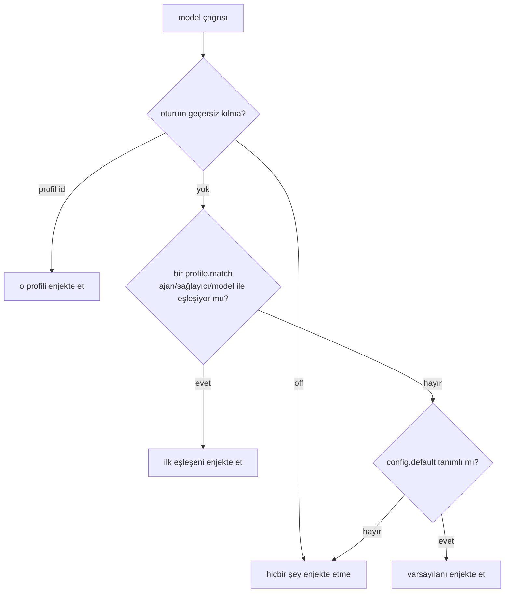

<p align="center">
  
</p>

<p align="center">
  <b>Sistem prompt'unu, kural setlerini ve host politikasını modele göre değiştir — host'u yamalamadan, dosyayla.</b>
</p>

<p align="center">
  <a href="README.md">English</a>
</p>

---

OpenCode her istek için tek bir sistem prompt'u kurar. `opencode-purge` o ana bildirimsel olarak müdahale eder: bir profil adı verirsin, kuralları eklersin; hangi oturumda hangisinin geçerli olacağına ajan, sağlayıcı ve modele göre eklenti karar verir.

`node_modules` ameliyatı yok. Vendor paketinin fork'u yok. Geri alınacak bir şey yok, çünkü hiçbir dosya ezilmiyor.

```
oturum geçersiz kılma  →  profil eşleşmesi  →  config varsayılanı  →  hiçbiri
```

## Neden

Prompt yapılandırması genelde iki kötü yerden birinde durur: `AGENTS.md` içine gömülmüş (her model için tek prompt, sonsuza kadar), ya da bir sonraki güncellemede bozulan fork ve yama script'lerine dağılmış.

`opencode-purge` bunu senin sahip olduğun tek bir dosyada tutar:

- **Modele göre prompt.** 9B yerel model ile frontier model aynı talimatı istemez. Aynı repo, aynı oturum, farklı profiller.
- **Prompt çorbası değil, kural seti.** `rules/testing.md`, `rules/style.md` ayrı dosyalar olarak kalsın, gerektiği yere eklensin.
- **Tasarımı gereği geri alınabilir.** Enjeksiyon istek anında `context` hook'unda olur. Diskte geri alınacak durum yoktur — `/purge off` geri alma işlemidir.
- **Açıklanabilir.** `/purge status` hangi profilin kazandığını **ve neden** kazandığını söyler. `/purge log` gerçekte ne enjekte edildiğini gösterir.
- **Sıfır çalışma zamanı bağımlılığı.** `node:fs` dışında hiçbir şey import etmeyen tek bir 32 KB dosya.

## Kurulum

```sh
opencode plugin add opencode-purge
```

Sürüm sabitlemek için:

```sh
opencode plugin add opencode-purge@0.1.0
```

<details>
<summary>Yerel kopyadan kurulum (geliştirme)</summary>

```sh
git clone https://github.com/zehedisode/opencode-purge
cd opencode-purge
bun install && bun run build
opencode plugin add /tam/yol/opencode-purge
```

</details>

Yeni paket eklentisi kurduktan sonra servisi yeniden başlat:

```sh
opencode service restart
```

## Hızlı başlangıç

Proje köküne `purge.jsonc` koy — ya da `.opencode/purge.jsonc`, ya da her projede geçerli olması için `~/.config/opencode/purge.jsonc`:

```jsonc
{
  "version": 1,
  "default": "terse",
  "profiles": [
    {
      "id": "terse",
      "name": "Kısa",
      "system": "Mümkün olan en az kelimeyle yanıtla. Giriş cümlesi, özet, övgü yok."
    },
    {
      "id": "reviewer",
      "description": "Büyük modeller için salt-okunur inceleyici",
      "systemFile": "profiles/reviewer.md",
      "rules": ["rules/severity.md"],
      "match": [{ "provider": "anthropic", "model": "*sonnet*" }]
    }
  ]
}
```

Bu dosyayla `*sonnet*` modellerinde her istek `reviewer` profilini alır, geri kalan her şey `terse` alır.

## Çözümleme



`off` açık bir karardır: hem `match` hem `default`'tan üstündür. Yani `/purge off` her zaman kapalı demektir.

Dosya sırasına göre eşleşen ilk profil kazanır. Özel profilleri genel olanların üstüne koy.

## Yapılandırma

| Alan | Tip | Varsayılan | Anlam |
| --- | --- | --- | --- |
| `version` | `number` | `1` | Şema sürümü. |
| `default` | `string \| null` | `null` | Hiçbir şey eşleşmezse kullanılan profil. `null` hiçbir şey enjekte etmez. |
| `profiles` | `Profile[]` | `[]` | Profiller. |
| `guard.mode` | `"off" \| "deny" \| "allow"` | `"off"` | Giden host politikası. |
| `guard.deny` | `string[]` | `[]` | `deny` modunda engellenecek host'lar. |
| `guard.allow` | `string[]` | `[]` | `deny` modunda yeniden izin verilecek, `allow` modunda tek izinli host'lar. |
| `audit.enabled` | `boolean` | `true` | Enjeksiyonları kaydet. |
| `audit.max` | `number` | `200` | Halka tampon boyutu, 1–5000. |

### Profil

| Alan | Tip | Anlam |
| --- | --- | --- |
| `id` | `string` | Zorunlu, benzersiz. `/purge use` bunu kullanır. |
| `name` | `string` | Görünen ad. Yoksa `id`. |
| `description` | `string` | `/purge profiles` çıktısında gösterilir. |
| `enabled` | `boolean` | `false` profili tamamen atlar. |
| `system` | `string` | Satır içi sistem prompt gövdesi. |
| `systemFile` | `string` | Gövde dosyası, config dosyasına göreli. |
| `rules` | `string[]` | Sırayla eklenen markdown dosyaları. Olmayan dosyalar atlanır. |
| `match` | `ProfileMatch[]` | Otomatik etkinleştirme seçicileri. |
| `agents` | `string[]` | Profili bu ajanlarla sınırlar (glob). |

`ProfileMatch` `provider`, `model` ve `agent` alanlarını kabul eder. Her `*` joker karakterdir, eşleşme büyük/küçük harf duyarsızdır:

```jsonc
"match": [
  { "provider": "anthropic", "model": "*opus*" },
  { "provider": "ollama" }
]
```

### Config nerede aranır

Sırayla, ilk bulunan kazanır:

1. `config` eklenti seçeneği verilmişse o
2. `<dizin>/.opencode/purge.jsonc`, sonra `purge.json`
3. `<dizin>/purge.jsonc`, sonra `purge.json`
4. üst dizinlerde 2 ve 3'ü tekrarla
5. `$XDG_CONFIG_HOME/opencode/purge.jsonc` (veya `~/.config/opencode/…`)

Değişiklikler bir saniye içinde alınır — yeniden başlatma gerekmez.

## Komutlar ve araçlar

Güvenilir arayüz araç setidir: her istemcide, her ajan çağırabilir.

| Araç | Amaç |
| --- | --- |
| `purge_status` | Şu an hangi profil geçerli, neden. |
| `purge_use` | Profili değiştir veya enjeksiyonu kapat. |
| `purge_doctor` | Config'i doğrula. |
| `purge_log` | Son enjeksiyonlar. |

Sadece sor: *"bu oturum hangi prompt profilini kullanıyor?"*, *"reviewer profiline geç"*, *"purge'ı kapat"*.

Eklenti ayrıca, eklenti komutlarını gösteren istemciler için slash komutları kaydeder:

| Komut | Etkisi |
| --- | --- |
| `/purge` | Geçerli profili ve neden seçildiğini gösterir. |
| `/purge profiles` | Tanımlı profilleri listeler. |
| `/purge use <id>` | Bu oturuma profil sabitler. |
| `/purge off` | Bu oturum için enjeksiyonu kapatır. |
| `/purge auto` | Otomatik seçime döner. |
| `/purge doctor` | Config'i doğrular. |
| `/purge log [n]` | Son enjeksiyonları gösterir. |

> [!NOTE]
> Slash komutları istemcinin eklenti komutlarını göstermesine bağlıdır. İstemcin bunları listelemiyorsa araçlar aynı işi yapar — hiçbir şey komutlara kilitli değil.

Oturum geçersiz kılmaları yeniden başlatmaya dayanır ve eklentinin kendi storage'ında tutulur — repona yazılmaz.

## Host guard

`guard`, her giden model isteğinin host adını süreçten çıkmadan önce kontrol eder.

```jsonc
{
  "guard": {
    "mode": "deny",
    "deny": ["*.telemetry.example", "collector.example"],
    "allow": ["gateway.example"]
  }
}
```

- `off` (varsayılan) — kontrol yok.
- `deny` — `deny` ile eşleşen host'ları engelle, `allow` ile eşleşenler hariç.
- `allow` — `allow` dışındaki her şeyi engelle.

Loopback (`localhost`, `127.0.0.0/8`, `::1`) asla engellenmez; yanlış bir desen yerel model sunucunu kesemez.

> [!WARNING]
> Engellenen istek, request hook'undan hata olarak fırlatılır ve o model çağrısını iptal eder. İhtiyacın yoksa kapalı bırak ve önce `/purge doctor` ile dene. Eklentinin `deneysel` kısmı burasıdır.

## Nasıl çalışır

Eklenti iki hook kaydeder ve hiçbir dosyaya dokunmaz:

- **`context`** — her model çağrısından önce profili çözümler ve tek bir sistem parçası ekler. Idempotent: istek zaten profil işareti taşıyorsa dokunmaz.
- **`http.request`** — yalnızca guard açıksa.

Enjekte edilen metin kendini tanımlar, böylece neyin eklentiden geldiği her zaman bellidir:

```html
<!-- opencode-purge:profile id="reviewer" source="match" -->
Bir diff inceliyorsun. Önce hataları bildir, sonra üslubu.

<!-- opencode-purge:rule path="rules/severity.md" -->
Blocker'lar doğruluk hatalarıdır...
```

`source` değeri `session`, `match` veya `default` olur — `/purge status` da aynı kelimeyi yazar.

## Tasarım notları

**Hiçbir şey yamalanmaz.** Eklenti `@opencode/*` içine yazmaz, dosya değiştirmez, geri yüklemek için yedek tutmaz. Kaldırmak, hiç kurmamış olmakla aynıdır. Bu, vendor paketini yerinde düzenleyen prompt araçlarından bilinçli bir farktır: o yaklaşım her güncellemeden sonra yeniden uygulanmak zorundadır ve host'tan sessizce sapabilir.

**Ret davranışı modelin, harness'ın değil.** OpenCode sistem prompt'unu, izin politikasını ve araç yüzeyini zaten ayrı katmanlarda tutar. Host'u yeniden yazmak, bir modelin reddetmek üzere eğitildiği şeyi değiştirmez — yalnızca gönderdiğin prompt ve seçtiğin model değiştirir. Bu eklenti iki kolu da dürüstçe verir ve fazlasını iddia etmez.

**Hata durumunda açık kalır (fail-open).** Config bozuksa veya kural dosyası yoksa istek prompt'suz devam eder, oturum kırılmaz. Bunu öğrenmenin yolu `/purge doctor`.

## Karşılaştırma

| | `opencode-purge` | dosya yamalayan jailbreak eklentileri |
| --- | --- | --- |
| Mekanizma | eklenti hook'ları | vendor paketlerini yeniden yazar |
| Güncellemelerden sonra | çalışır | yeniden uygulanmalı |
| Geri alma | config'i sil | yedekleri geri yükle |
| Denetlenebilir | enjekte metin etiketli | düzenlemeler çalışma anında görünmez |
| Kapsam | prompt + host politikası | prompt + host iç yapısı |

## SSS

**Modelin retlerini kaldırır mı?** Hayır. Kendi makinende prompt'u ve istek kapsamını kontrol eder. Model davranışı modelin kendisidir.

**İstekleri yavaşlatır mı?** Config önbelleklenir ve en fazla saniyede bir kez stat edilir. Kurallar yalnızca config değişince yeniden okunur.

**İki proje farklı profil kullanabilir mi?** Evet — config keşfi en yakın dosyayı tercih eder, yani proje config'i global olanı geçer.

**Alt ajanlarla çalışır mı?** Evet. `agents` ve `match.agent` ajana göre seçer; her alt ajan isteği bağımsız çözümlenir.

## Geliştirme

```sh
bun install
bun run check   # typecheck + testler
bun run build   # dist/index.js + tip tanımları
```

Derlemek için Bun ≥ 1.4, çalıştırmak için Node ≥ 20.

## Lisans

MIT. Bkz. [LICENSE](LICENSE).

Bir kodlama harness'ı için yapılandırılabilir prompt enjeksiyonu katmanı fikri, DeepSeek Harness için [YuJunZhiXue/dsh-purge](https://github.com/YuJunZhiXue/dsh-purge) tarafından popülerleştirildi. Bu proje OpenCode'un eklenti API'si için bağımsız bir uygulamadır, onunla kod paylaşmaz ve [NOTICE](NOTICE) içinde kredi verir.
